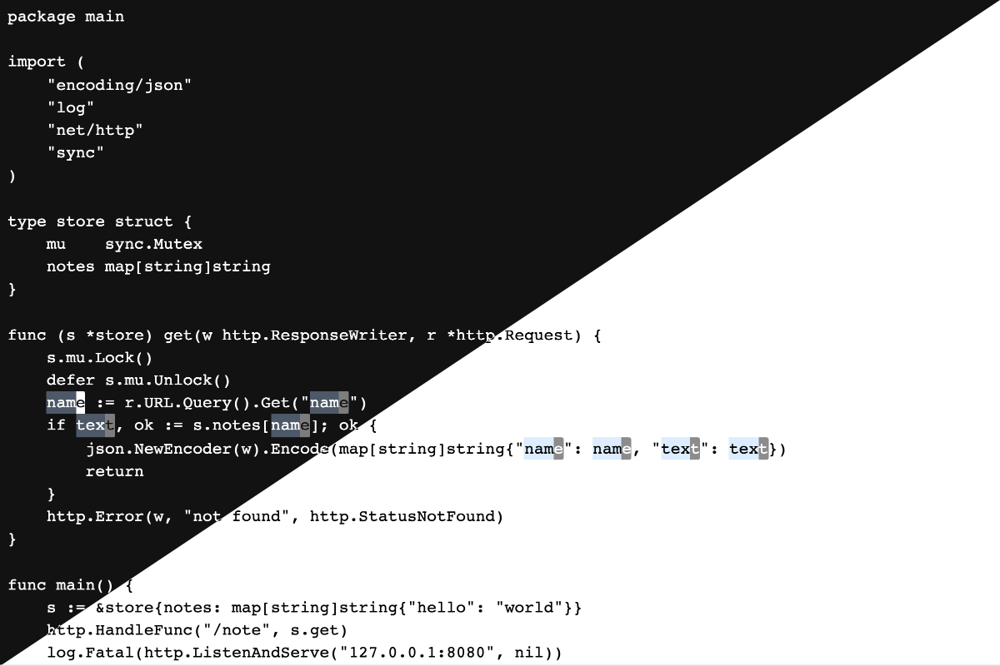
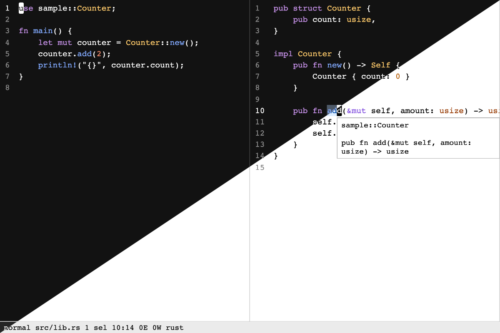

# helix-cm6

helix-cm6 adds [Helix](https://helix-editor.com) editing to [CodeMirror 6](https://codemirror.net). It is ported from Helix's source and tested against real Helix.



## Install

```sh
npm install helix-cm6 @codemirror/state @codemirror/view @codemirror/commands
```

`@codemirror/state`, `@codemirror/view` and `@codemirror/commands` are peer dependencies. To install from GitHub instead, use `github:Kosyakssss/helix-cm6#0.1.3`. `dist/` is committed, so nothing builds on install.

## Use

Add `helix()` to your editor:

```ts
import { EditorView } from "@codemirror/view";
import { helix } from "helix-cm6";

new EditorView({ parent: document.body, extensions: [helix()] });
```

This gives you Helix's editing: the keymap, selections, multiple cursors, registers, macros, the undo tree, text objects, surround, jump labels and typed commands.

To connect your app, give Helix its commands. `helixAppKeys` adds Helix's keys for the commands you supply, so `Space f` opens your file picker:

```ts
import { helix, helixAppKeys, helixMarkSaved } from "helix-cm6";

const extension = helix({
  config: helixToml,
  keys: helixAppKeys,
  commands: {
    file_picker: () => openFilePicker(),
    write: async ({ view }) => {
      await saveNote(view.state.doc.toString());
      helixMarkSaved(view);
    },
  },
});
```

[Build an app](docs/build-an-app.md) goes through this step by step.

## Your app

helix-cm6 is an editing core. It holds what Helix does to text, and draws cursors, selections, jump labels, the key help and a small command line.

Your app brings the rest: files, tabs, pickers, a status bar, gutters, colors and language servers. helix-cm6 gives you the data for these and runs your commands.



More in [docs/screenshots](docs/screenshots), each in dark, light and both: the key help, a selection grown by the syntax tree, the command line, jump labels and a code editor.

## Documentation

- [Build an app](docs/build-an-app.md)
- [Commands](docs/commands.md)
- [Keys](docs/keys.md)
- [Config](docs/config.md)
- [Draw your UI](docs/ui.md)
- [Languages](docs/languages.md)
- [Language servers](docs/language-servers.md)
- [Colors](docs/colors.md)
- [Hooks](docs/hooks.md)
- [API reference](docs/api.md)
- [How it works](docs/how-it-works.md)

[`examples`](examples) has three apps, from one line to a code editor with a language server. For an Obsidian plugin, see [helix-motions](https://github.com/Kosyakssss/helix-motions).

## Compatibility

helix-cm6 follows Helix master at commit `a714a818a3`. About 44,000 key sequences run in real Helix and in this engine, and the text, the selections and the mode after each one must match exactly. [docs/parity.md](docs/parity.md) lists every Helix command and option.

Screen readers and right-to-left text are not tested yet.

The API can change until 1.0.

## Develop

```sh
bun install
bun run check
bun test
bun run browser
bun run views
bun run play
```

`bun run play` serves a bare editor to try changes by hand. See [Contributing](CONTRIBUTING.md) and [Testing](docs/testing.md).

To port a Helix fork, fork this repo, port the fork's changes and point `test/oracle/setup.sh` at the fork's commit. The tests then check the port against the fork.

## License

[MPL-2.0](LICENSE). The wasm modules contain code under other licenses: see `tree-sitter/NOTICE` and `regex/NOTICE`.
